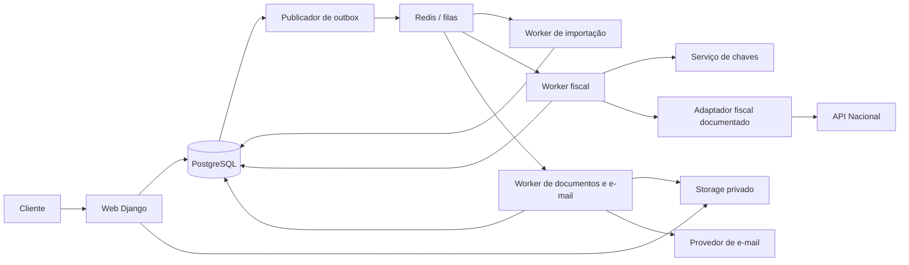

# Arquitetura proposta

Status: desenho para aprovação; módulos, tabelas e comandos ainda não existem. O desenho atende ao monólito modular com processo de workers separado exigido na especificação.

## Comparação de tecnologias

| Alternativa | Vantagens neste produto | Custo ou limitação | Decisão proposta |
| --- | --- | --- | --- |
| Django + Python + Celery | Autenticação, sessões, ORM, migrações e administração maduros; ecossistema de planilhas, PDF, criptografia e XML | Tipagem exige disciplina; confirmar bibliotecas e manutenção de cada dependência | Recomendada |
| NestJS + TypeScript + BullMQ | Tipagem compartilhada, ecossistema web e filas | Mais composição para autenticação/admin; extração PDF/OCR pode introduzir segundo runtime | Alternativa válida se a equipe priorizar TypeScript |
| ASP.NET Core + workers .NET | Tipagem, bom suporte a certificados e XML | Mais especialização para importação heterogênea e menor reaproveitamento do ecossistema Python | Alternativa válida para equipe .NET |
| FastAPI + frontend separado | APIs tipadas e flexibilidade | Mais componentes para conta, sessões, administração e autorização | Benefício insuficiente no início |

Stack-base proposta: Python 3.12, Django 5.2 LTS, PostgreSQL 17, Celery 5 e Redis 7. Confirmar patches suportados, licenças e compatibilidade na Fase 1; estas linhas de versão não constituem um lockfile nem uma avaliação atual de vulnerabilidades. Redis será transporte/cache, nunca fonte única do estado fiscal. Reavaliar broker se os testes de entrega, memória ou operação indicarem necessidade.

Interface: templates Django + HTMX e CSS responsivo, mantendo uma origem e sessões no servidor. Evita manter uma SPA e duas camadas de autenticação no MVP. React poderá ser avaliado por necessidade comprovada, não como requisito. Django Admin servirá à operação interna com permissões específicas; não dará acesso automático a certificados, documentos ou dados de todos os clientes.

Dependências candidatas: leitor CSV padrão, openpyxl para XLSX, biblioteca de extração de texto PDF e OCR em processo isolado quando necessário, cryptography para PKCS#12/envelope, biblioteca XML com entidades externas desabilitadas. Escolhas exatas dependem de amostras, licença, segurança e testes; nenhuma biblioteca fiscal não oficial substituirá a especificação vigente.

## Componentes e fronteiras



Mesmo código, imagem e banco; comandos e permissões diferentes por processo. Web não precisa de permissão para descriptografar A1. Importador/OCR não recebe certificado nem acesso de emissão. Escalar workers não requer separar serviços de domínio. Outbox é publicada por processo próprio ou worker periódico com configuração verificada; processo recorrente também precisa de instruções de reinício.

## Estrutura de pastas planejada

```text
AGENTS.md
README.md
docs/
pyproject.toml e lockfile
manage.py
config/                    # settings por ambiente, URLs, Celery
apps/
  identity/                # conta, sessão, MFA e recuperação
  tenancy/                 # tenant, vínculo e autorização
  companies/               # CNPJ e enquadramento por vigência
  certificates/            # metadados, envelope e acesso mínimo
  imports/                 # arquivos, lotes e processamento
  marketplaces/            # adaptadores Shopee/TikTok/Mercado Livre
  commissions/             # normalização e rastreabilidade
  recipients/              # identidade, resolução e revisão
  tax_configuration/       # perfis e regras aprovadas/versionadas
  invoicing/               # prévia, confirmação, estado e idempotência
  integrations/            # Nacional, e-mail, storage, pagamentos
  jobs/                    # outbox, leases, reconciliação e supervisão
  documents/               # artefatos e autorização de download
  notifications/           # e-mails independentes da situação fiscal
  billing/                 # planos, consumo e webhooks
  dashboard/               # métricas reais do tenant
  administration/          # suporte e indicadores privilegiados
  audit/                   # eventos sem conteúdo sensível
templates/
static/
tests/                     # unidade, integração, isolamento, e2e
ops/                       # desenvolvimento, operação e recuperação
```

Criar módulos incrementalmente. Estruturas internas: domínio/serviços de aplicação, modelos e adaptadores. Não construir abstrações vazias apenas para preencher essa árvore.

## Modelo inicial de dados

UUID para identificadores públicos, instantes UTC, competência `AAAA-MM`, moeda explícita e Decimal com precisão definida antes das migrações. Linhas de origem preservam valor original, precisão e arredondamento aprovado; totais não passam por float. Fuso e competência vêm da origem/regra aprovada, não de inferência do instante UTC.

| Entidade proposta | Campos e relações principais | Garantias |
| --- | --- | --- |
| Account/User, Tenant, Membership | Conta, tenant, papel, vínculo; um principal inicialmente | Sessão determina vínculo ativo; recuperar conta não altera tenant |
| Company | tenant, CNPJ normalizado, município, dados cadastrais | UNIQUE(tenant, CNPJ); validação de formato/DV não prova cadastro ativo |
| CompanyRegimeHistory | company, regime, porte, início/fim de vigência | Sem intervalos conflitantes; regime normal bloqueado; competência usa histórico |
| TaxProfileVersion | company, vigência, códigos, tributação, evidência, aprovador | Versão imutável após uso; sem defaults fiscais inventados |
| EligibilityEvidence | company, ambiente, competência/faixa, fonte e verificação | Norma e prontidão operacional separadas; pendência impede transmitir |
| Certificate | company, metadados, validade, fingerprint, referência do envelope e versão da chave | Cifra privada; sem senha em logs; associação ao CNPJ comprovada |
| SourceFile/ImportBatch | company, plataforma, hash do arquivo, layout, período, estado | Hash detecta repetição binária; não substitui identidade da comissão |
| ImportRow/Commission | lote, origem, ID estável, valor/moeda, período, modalidade, resolução | Proveniência e erro por linha; UNIQUE no escopo do ID estável confirmado |
| Recipient/RecipientVersion | tenant, identidade fiscal/país, nome/endereço, evidência | Snapshot imutável utilizado na prévia; país não determina tributação |
| Resolution/GroupingRuleVersion | plataforma, modalidade, evidência, vigência, revisor | Ambiguidade gera pendência; sem agrupamento automático presumido |
| InvoiceDraft/DraftLine | emissor, competência, tomador, perfil, total, revisão, hash | Cada comissão alocada no máximo uma vez; linhas preservam origem |
| BatchConfirmation | conjunto de drafts, versão/hash, autor, instante | Dados mudados invalidam confirmação; sem cobrança ou emissão implícita |
| FiscalOperation | draft, ambiente, identidade fiscal oficial quando definida, idempotency key, estado | Chave única estável por operação, independente de tentativas |
| TransmissionAttempt | operação, número, lease, instante, resultado sanitizado | Histórico imutável; tentativa não é uma nova operação |
| FiscalDocument/Event | operação, prova de autorização, número/chave, protocolo, eventos | Documento autorizado só com resposta fiscal válida; cancelamento é evento confirmado |
| DocumentArtifact | tenant, company, documento, tipo, checksum, storage key | Bucket privado; metadados e objeto coerentes e autorizados |
| EmailDelivery/EmailAttempt | documento, destinatário aprovado, tipo, versão, estado e tentativas | Deduplicação de intenção; estado de e-mail independente do fiscal |
| Plan/Subscription/UsageLedger | versões de preço, período de cobrança, eventos de consumo | UNIQUE(documento, tipo de evento); contabilização transacional |
| PaymentEvent | provedor, identificador do evento, assinatura, estado | Webhook idempotente, validação de assinatura e reconciliação |
| OutboxEvent/InboxReceipt/JobLease | evento, tipo, entidade, estado e vencimento | Entrega pelo menos uma vez; consumidor idempotente |
| AuditEvent | tenant, ator, ação, entidade, instante e correlation ID | Sem certificados, senhas, relatórios completos ou XML sensível |

Todas as entidades do cliente carregam tenant; relações usam chaves estrangeiras compostas `(tenant_id, parent_id)` para impedir associação cruzada, não apenas UUIDs globais e filtros no ORM. Tabelas globais, como catálogo de planos, têm privilégios explícitos. Índices focam tenant, emissor, competência, estado e instante; particionamento só após métricas.

RLS em PostgreSQL como defesa adicional: contexto por transação via `SET LOCAL`, papel sem BYPASSRLS e sem propriedade das tabelas, políticas fail-closed, teste de reutilização de conexão e worker. Papel de migração separado. Não rodar a aplicação como superuser. Constraints e autorização de domínio continuam necessárias.

### Identidades e consolidação

Separar: arquivo binário, evento de comissão, draft, operação fiscal e tentativa. Hash de arquivo não detecta toda reexportação; valor+tomador+competência não identificam unicamente uma operação. ID da origem precisa ter escopo documentado por plataforma. Sem ID estável, manter evidência e revisão de colisões, não descartar linhas iguais automaticamente.

Consolidar somente com regra aprovada para a modalidade, dentro de tenant, emissor, tomador comprovado, competência, moeda e configuração fiscal compatível. Modalidades só se unem quando a regra expressamente permitir. Alterações do tomador exigem nova revisão. Estornos, negativos, revisões após emissão e relatórios corrigidos precisam de política; não gerar nota negativa ou emitir diferença automaticamente. Operações estrangeiras têm tratamento fiscal aprovado, nunca exportação por país.

Prévia e confirmação ocorrem em transação: bloquear versão do draft e alocações de comissão, conferir limites/reservas, persistir operação e outbox com constraints únicas. A chave HTTP de idempotência é vinculada a tenant, ação e hash da requisição; mesma chave com payload diferente retorna conflito. Ela não substitui as identidades de negócio.

## Fluxo de emissão e filas

1. Autenticar, escolher CNPJ autorizado e competência; validar escopo do regime e evidências, sem inferir parâmetros tributários.
2. Receber arquivo com limite, assinatura de tipo, hash e armazenamento privado. Enfileirar processamento com IDs, nunca conteúdo sensível na mensagem.
3. Adaptador de layout versionado identifica origem; extrai texto do PDF antes de avaliar OCR. Arquivo protegido, inválido, não reconhecido ou de baixa confiança vai para correção. OCR não resolve identidade fiscal automaticamente.
4. Normalizar e resolver cada comissão; pendências impedem que a linha seja emitida. Totais da origem, linhas aceitas, excluídas e pendentes devem conciliar.
5. Gerar agrupamentos permitidos e prévia com origem, tomador, valores e configurações. Cliente confirma exatamente aquela versão; alterações exigem confirmação nova.
6. Persistir operações e eventos de outbox na mesma transação. Publicador entrega à fila; queda após publicar pode duplicar entrega, que deve ser absorvida pelo consumidor.
7. Worker obtém lease e transição atômica, revalida tenant/emissor/configuração/certificado. Antes da chamada fiscal, grava tentativa e estado que registra a possibilidade de envio. Usar identificador fiscal permitido pela documentação, ainda a definir.
8. Interpretar resposta fiscal conforme esquema e códigos oficiais. HTTP 2xx, resposta incompleta ou XML inválido nunca bastam para autorizar. Timeout, queda após envio ou lease expirado após possível transmissão resultam em **resultado incerto**.
9. Incerto ou aguardando confirmação vai à fila de consulta/reconciliação, nunca à retransmissão automática. Só retomar envio se mecanismo oficial provar que é seguro; “não encontrado” pode refletir propagação e não é prova universal de não emissão. Sem consulta conclusiva, bloquear e encaminhar revisão.
10. Autorização comprovada persiste documento, ledger de consumo e evento de documentos/e-mail de forma atômica. Recuperação de PDF/XML não gera nova emissão. Eventos repetidos não duplicam consumo.
11. Enviar documento por fila independente; falha de e-mail nunca invoca transmissor. Registrar aceite do provedor separado de entrega; usar idempotência do provedor quando disponível. Sem ela, timeout de e-mail também pode gerar estado incerto: evitar promessa de entrega exatamente uma vez.
12. Cancelamento e substituição só entram após confirmar suporte/regra. Pedido enviado é estado próprio; nota só se torna cancelada mediante evento fiscal comprovado.

Estados fiscais mínimos: pendente, em processamento, aguardando confirmação, autorizada, rejeitada, resultado incerto e cancelada. Modelar cancelamento solicitado e resultado de substituição separadamente. Rejeitada só é reprocessável conforme código e ausência de autorização confirmada. Autorizada não volta a pendente. Estado de fila/lease, estado fiscal e entrega de e-mail são distintos.

Filas: importação/OCR, transmissão, consulta, documentos e e-mail. Limites por emissor e provedor, backoff com jitter e respeito a Retry-After documentado; circuit breaker e fila de intervenção após tentativas limitadas. Desabilitar retry genérico de chamadas fiscais mutantes. Paginação, streaming de leitura, limites de CPU/memória e proteção contra ZIP bombs para XLSX/PDF. OCR em sandbox sem egress e sem segredos.

Banco é autoridade; reconciliador recupera eventos não publicados e leases vencidos sem retransmitir uma emissão possivelmente enviada. Testar queda antes/depois de envio, antes/depois de commit e entrega duplicada. Meta é efeito de negócio idempotente, não garantia fictícia de fila exactly-once.

## Segurança dos certificados e dados

Upload A1 por HTTPS, validação PKCS#12, senha, titular, validade e associação à empresa conforme campos e regras verificadas. Nunca considerar um simples parse como verificação completa de cadeia/identidade. Limitar tamanho e tentativas; nenhum A1 real é necessário na descoberta.

Envelope: gerar DEK aleatória por versão do certificado, cifrar conteúdo e senha com AEAD (por exemplo AES-256-GCM), nonces únicos e contexto autenticado que inclua tenant/company/certificate/version. Cifrar DEK com chave mestra KMS gerenciada. Banco/objeto guarda apenas ciphertext, nonce, tag, versão e DEK cifrada. Papel de worker fiscal tem permissão mínima de decrypt, sem exportação de chave mestra. Bind do contexto impede trocar envelopes entre empresas.

Se não houver KMS, propor Vault Transit equivalente com gestão, auditoria e backup separados. Não usar chave fixa no código, no banco ou variável compartilhada de todos os processos como solução de produção. Sem mecanismo seguro aprovado, upload e emissão ficam bloqueados. Certificado e senha são decifrados apenas no worker e em memória; confirmar suporte de mTLS/assinatura sem persistência em disco. Se a biblioteca exigir arquivo em claro, selecionar alternativa antes da implementação. Python não garante zeragem completa de memória; usar processos de curta duração e impedir core dumps/swap desprotegido onde aplicável.

Rotação: rewrap das DEKs por versão, leitura compatível durante transição, teste de recuperação e revogação de acesso; substituir certificado sem perder metadados e documentos já emitidos. Exclusão considera jobs ativos e retenção aplicável, com revogação e descarte de chave quando permitido. Backups cifrados não podem ficar sem caminho independente de recuperação das chaves.

Contas: sessões server-side, cookies HttpOnly/Secure/SameSite, CSRF, hashes fortes de senha, verificação de e-mail, MFA/TOTP e recuperação de sessão com rate limiting e códigos de recuperação protegidos. Políticas de senha e dependências serão definidas na fundação. Área administrativa com MFA obrigatório e concessões de suporte temporárias auditadas, sem acesso irrestrito aos A1.

Storage privado com URLs assinadas curtas somente após autorização no backend; tenant no caminho é defesa auxiliar, não permissão. Downloads e ZIP validam cada documento; impedir path traversal. Uploads sem execução/preview de conteúdo ativo. Exportações CSV escapam fórmulas. Dados pessoais minimizados e acesso aos relatórios restrito.

Observabilidade: eventos estruturados com IDs técnicos, duração e códigos permitidos; remover payloads de certificados, XML fiscal, relatórios, CPF/CNPJ completo, endereço, senhas e tokens. Auditoria de operações sensíveis com acesso e retenção específicos. Métricas: backlog, idade de resultado incerto, rejeição por código, latência, certificados a vencer e entrega de e-mail. Alertas não enviam dados pessoais.

Backups automáticos cifrados de banco e objetos, chaves separadas, restauração em ambiente isolado testada antes de produção. Objetivos iniciais a validar no orçamento: RPO até 24h e RTO até 8h; não são SLA contratado. Antes de reativar worker restaurado, reconciliar emissões posteriores ao ponto de backup. Restauração de banco antigo não autoriza reenviar operações. Retenção fiscal, bases legais, exportação e exclusão LGPD requerem avaliação jurídica; não adotar prazo fictício universal.

## Consumo e pagamentos — proposta a validar

Unidade: NFS-e comprovadamente autorizada. Rejeição, tentativa, resultado incerto e duplicata evitada não consomem. Cancelamento não estorna automaticamente consumo já realizado. Substituta autorizada seria novo consumo, sem novo consumo para mera recuperação do mesmo documento. Esses dois tratamentos comerciais precisam de aprovação e termos claros, inclusive exceções por erro do sistema, antes de implementação.

Período do plano e competência fiscal são conceitos distintos; definir timezone e fronteiras do ciclo. Reservas transacionais ao confirmar evitam que duas filas ultrapassem limite sem consentimento. Autorização consome reserva exatamente uma vez; rejeição definitiva libera; incerta mantém reserva até reconciliação. Excedente apenas com regra/preço previamente aceitos; sem decisão comercial, bloquear ao atingir limite.

Provedor de pagamento a escolher com cartão tokenizado/checkout hospedado, PIX e webhooks assinados. Não presumir PIX recorrente disponível. Eventos com chave única, replay protection e reconciliação do estado evitam assinatura ativa por payload forjado ou evento fora de ordem. Nenhum número completo de cartão será armazenado.
