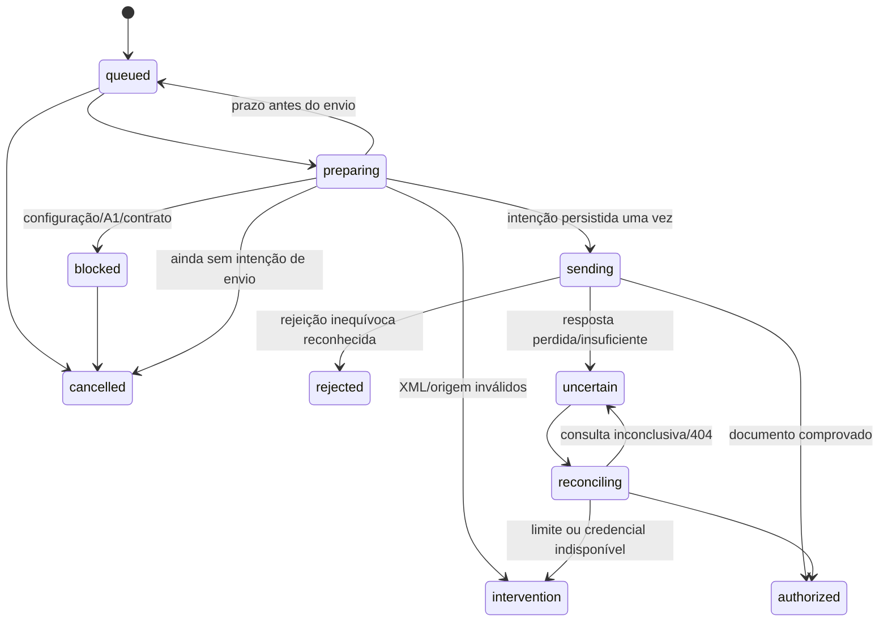

# Fila fiscal e nota avulsa para afiliados

## Entrega e configuração

Esta etapa acrescenta `/painel/notas`, `/painel/notas/nova` e o acompanhamento por lote. A fila, numeração, proteção contra duplicidade, recuperação e integração condicional de homologação estão implementadas. **Não houve teste com A1 real nem homologação do envio. Produção permanece bloqueada.** A documentação OpenAPI oficial ainda precisa ser capturada e reconhecida; respostas de testes não são evidência de compatibilidade do serviço real.

O usuário confirmou as migrações 1–9, informou que terá o A1 no próximo dia e confirmou o CNPJ Shopee `35.635.824/0001-12`. Identidade e endereço foram consultados na BrasilAPI: **SHPS TECNOLOGIA E SERVICOS LTDA.** Proveniência e campos selecionados estão em `integrations/marketplaces/shopee-recipient.json`. Não foram armazenados QSA ou dados de sócios. O vínculo de tomador foi informado pelo usuário; a consulta cadastral não comprova a classificação fiscal da comissão.

Aplicar somente, em ordem:

1. `supabase/migrations/202611110010_fiscal_queue.sql`.
2. `supabase/migrations/202611110011_standalone_templates.sql`.

Não repetir as migrações anteriores. Não executar `tests/database` no projeto remoto. As novas migrações criam estruturas/funções e índices próprios, sem alterar funções gerenciadas do Vault nem apagar dados anteriores.

Se a migração 11 retornar `42P07: relation "standalone_templates" already exists`, não apagar a tabela nem repetir scripts. Executar somente a consulta de metadados `supabase/diagnostics/standalone-status.sql` e conferir os oito resultados. A consulta não altera dados nem lê certificados ou notas; compara também o corpo da função com a versão encaminhada. Todos `true` indicam que as verificações passaram; resultado diferente exige examinar a estrutura existente antes de preparar uma migração corretiva. Não substituir a migração original por `IF NOT EXISTS`, pois isso poderia esconder uma estrutura incompleta.

Manter `SUPABASE_SERVICE_ROLE_KEY` e `CRON_SECRET` somente no servidor, conforme `configurar-processamento.md`. A variável privada `NFSE_HOMOLOGATION_ENABLED` tem valor inicial **false**. Não usar prefixo `NEXT_PUBLIC` para essas variáveis. Não enviar valores ou A1/senha pelo chat.

## Nota avulsa

Depois de cadastrar a empresa e confirmar o perfil fiscal uma vez, o formulário abre com o tomador Shopee, endereço, descrição e parâmetros do perfil preenchidos. Somente o valor fica vazio. A competência inicial é a data corrente em **America/Sao_Paulo**, aparece no resumo e pode ser alterada. Não é inferida de CSV nem gravada como padrão permanente.

Em “Alterar dados da nota”, o usuário pode editar competência, tipo de comissão, referência de pagamento, tomador/endereço, descrição, códigos e parâmetros fiscais. Alterações podem ser lembradas em um modelo versionado da própria empresa; o modelo não guarda valor, competência ou referência de uma nota anterior. Quando o perfil fiscal base muda, os parâmetros antigos não são reaplicados automaticamente. A razão social, documento e competência do resumo acompanham as edições do formulário.

Código de serviço, alíquota, retenção e regime especial vêm do perfil confirmado, sem dedução a partir do CNAE. Sem perfil válido, o fluxo conduz à configuração inicial. O modelo também permite intermediário e tomador diferente; exterior exige dados adicionais e parâmetros próprios. Valores em formato brasileiro são convertidos por strings/BigInt, sem float, arredondamento ou conversão cambial.

“Avulsa” significa emissão individual sem CSV neste produto. Não muda `tpEmit` nem solicita o regime fiscal especial de NFS-e avulsa (`cStat=103`). O fluxo continua sendo DPS de prestador MEI/Simples no modelo Nacional.

## Numeração, confirmação e duplicidade

- Revisão de relatório exige confirmação prévia do snapshot exato. Depois o usuário escolhe colocar o lote na fila; preparar ou confirmar a revisão não enfileira automaticamente.
- Antes do A1, operações e escopos são reservados somente no próprio tenant. Não expõem nem ocupam o espaço de outra conta com o mesmo CNPJ cadastrado. DPS/número continuam nulos e a interface explica a pendência.
- O worker inspeciona o A1 protegido e exige resposta JSON 200 da consulta **oficial por mTLS** antes de registrar acesso e reservar a numeração compartilhada do emissor. Essa resposta comprova acesso ao transporte, não autorização fiscal. Metadados locais de PKCS#12, sozinhos, não liberam a reserva.
- A numeração é transacional por CNPJ/município/série/ambiente, compartilhada entre contas que efetivamente possuem acesso ao emissor. Série própria permitida: 00001–49999. Selecionar uma série reservada para esta aplicação; não presumir continuidade de números usados por outro sistema. Colisão informada pelo serviço exige consulta/intervenção, sem busca automática de novo número e retransmissão.
- Os escopos de loja/mês do CSV impedem reaproveitar a mesma comissão em reexportações com bytes/valores alterados. Nenhum lote parcial é criado se qualquer escopo já estiver reservado. A reserva entre contas só ocorre após a conferência do A1/acesso oficial.
- Nota individual possui identificador da solicitação mantido em repetição após falha ou resposta perdida. Pagamento com referência usa essa referência e a identidade do tomador, sem mudar o escopo ao editar valor/endereço/tributação. Sem referência, CNPJ emissor, tomador, competência e valor identificam a repetição; para outro pagamento com os mesmos dados, informar referência própria.
- Não há prova automática de equivalência entre uma nota manual sem referência e linhas de um CSV. Não prometer deduplicação sem origem comum entre esses dois fluxos.
- Cancelamento local só existe antes de iniciar transmissão. Libera escopos da preparação, mas não reutiliza números já reservados. Não é cancelamento fiscal de nota autorizada.

## Máquina de estados

Cada job tem lease com token privado. Token antigo não inicia envio nem conclui uma reserva nova. O banco registra `sending` e `transmit_count=1`, XML assinado e certificado público **antes** do POST; apenas uma chamada obtém essa permissão. Se a resposta desse registro se perde, o worker não inicia POST sem confirmação, e a reserva expirará para consulta. Se o processo cai após iniciar o POST, também expira para consulta. Nunca há transição de operação enviada para uma nova preparação.

Após envio incerto, usar GET `/dps/{id}` e GET `/nfse/{chave}` conforme caminhos/campos declarados no contrato oficial capturado. **404 não autoriza reenvio.** Consultas têm espera crescente, até 12 tentativas; “Consultar novamente” continua usando apenas GET. Certificado público da assinatura original permanece vinculado à DPS. A conexão de consulta pode usar novo A1 válido do mesmo emissor, preservando verificação do documento antigo após substituição do certificado.

## Contrato e prova de autorização

O adaptador permanece bloqueado se a documentação oficial não declarar os caminhos e propriedades que ele implementa. Não basta existir `/nfse`. As fixtures OpenAPI em testes são expressamente sintéticas; não foram publicadas no registro oficial da aplicação. O manual/XSD consultados e seus hashes continuam em `integrations/nfse/provenance.json`. A política RSA-SHA256/SHA256/C14N precisa de validação no serviço real.

No caminho condicionado ao contrato, a DPS é assinada, validada por XSD e comprimida em gzip/base64. Somente destinos fixos oficiais do ambiente escolhido são aceitos, com validação TLS, mTLS, prazo e limite de resposta. POST só é permitido em `/nfse`; não segue redirecionamentos.

Uma resposta 2xx só vira `authorized` após verificar base64/gzip/UTF-8 com limite de expansão, XSD NFS-e, chave/Id, emitente, resultado 100/107, assinatura da NFS-e e correspondência canônica entre `infDPS` retornado e a requisição assinada original. Se a DPS retornada contiver assinatura, ela também precisa verificar; sua ausência é permitida pelo TCDPS retornado, mantendo os dados sob a assinatura externa verificada. O certificado dessa assinatura externa é vinculado à resposta obtida do canal oficial autenticado; isso não é uma validação independente completa da cadeia ICP/CRL de um XML enviado por qualquer pessoa. O sistema não aceita upload de XML como prova de autorização.

Documento, hash e estado são gravados na mesma transação, uma vez por operação. Download de XML exige sessão autenticada, propriedade e hash correto, com `private, no-store`. Respostas brutas do provedor, XMLs, senhas, chaves e tokens não vão a logs. PDF, e-mail transacional, cobrança e liberação de produção continuam em etapas próprias; nenhum documento demonstrativo é apresentado como nota real.

## Execução na Vercel

Uma invocação processa um relatório ou uma operação fiscal, com orçamento e limite de 60 segundos. `after()` permite iniciar trabalho após a resposta ao usuário. Uma chamada interna autenticada pode solicitar outra invocação, até 500 passos por disparo. O segredo vai somente no header para a origem configurada da própria aplicação, sem redirecionamentos. Não depende de manter o navegador aberto e não cria servidor residente.

O Cron de recuperação continua diário, compatível com Hobby. Não há promessa de consulta contínua a cada minuto; esperas futuras, interrupção da cadeia ou falha da plataforma dependem de Cron ou retomada pelo painel. Preparação tenta até cinco vezes; falta de dependência não consome o mesmo limite como se fosse uma tentativa de transmissão. Fechar o navegador não elimina jobs ou leases.

## Roteiro para o A1

Estado atual: a migração 15 foi confirmada, seguida de 404/contrato pendente. A atualização da consulta ADN, leitor Redoc e relatório copiável está em [diagnóstico de homologação](diagnostico-homologacao.md). Não repetir a 15. A consulta do botão é informativa; o guard da fila exige resposta de consulta SEFIN própria conforme o contrato capturado, sem liberar números apenas por parâmetros do ADN.

O usuário já confirmou armazenamento protegido do A1, seguido de erro genérico na consulta e depois `NFSE_HTTP_404`. A correção de transporte/diagnóstico e o ajuste posterior do prefixo estão em [diagnóstico de homologação](diagnostico-homologacao.md). Não exigir novo upload nem repetir migrações anteriores. O ajuste de origem documental usa somente a migração 15.

1. Cadastrar o A1 pela aplicação e executar “Verificar acesso à homologação”. Não enviar certificado/senha por chat.
2. Conferir captura/versão do contrato oficial e compatibilidade dos algoritmos/campos; documentação desconhecida mantém o envio bloqueado.
3. Só após essa conferência, configurar `NFSE_HOMOLOGATION_ENABLED=true` no servidor Vercel e fazer novo deploy.
4. Retomar uma operação de teste explícita no painel e verificar resultado/documento. Não enviar automaticamente o CSV real como teste.
5. Produção segue bloqueada; não existe troca para produção pelo formulário, payload ou essa variável.

## Testes

Unitários cobrem precisão monetária, identidade/numeração, estrutura de contrato, expansão gzip, perda de resposta antes/depois de registrar intenção, 2xx sem documento, E0014, consulta 404, ausência de A1, proteção de produção e recibos assinados sintéticos. PostgreSQL real testa isolamento, confirmação, escopos locais/globais, modelos, rollback, fencing e sequenciamento concorrente entre duas contas. Tokens e Auth dos testes são simulados apenas no banco descartável; não comprovam Vault real, ICP-Brasil ou homologação.

UI usa componentes reais com ações de fronteira sintéticas: apenas valor necessário com dados válidos preexistentes, detalhes editáveis, resumo atualizado, nonce de repetição, nova solicitação, preservação após erro, controles sem reenvio incerto e ausência de overflow em 1440/1024/820/768/390/320 px. Não é teste logado no projeto Supabase hospedado.
